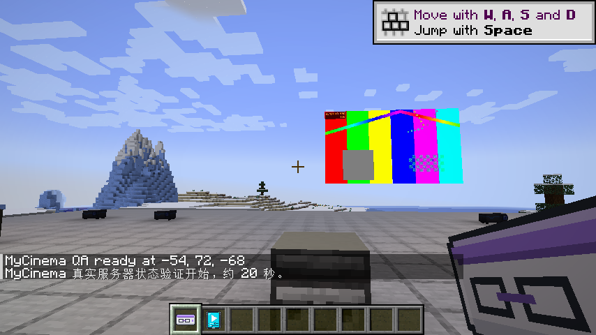
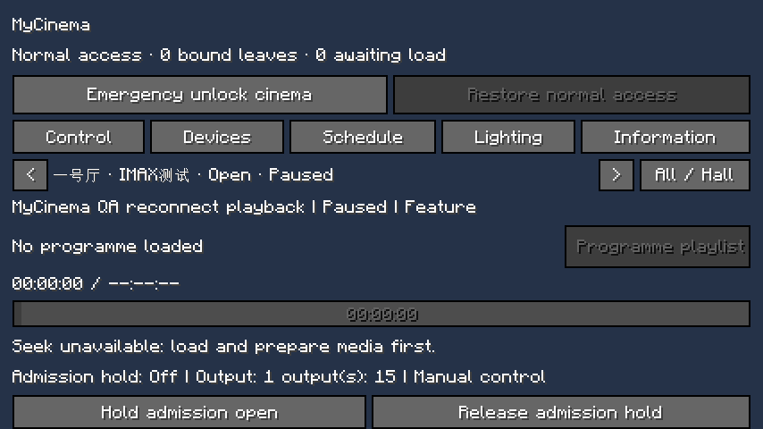
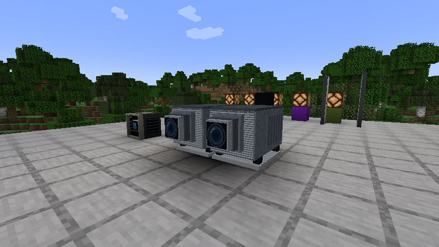
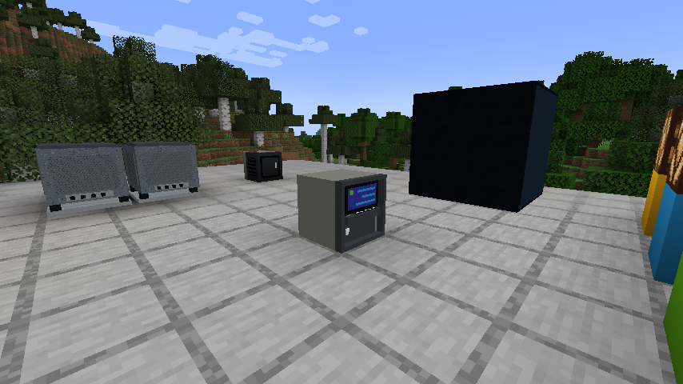
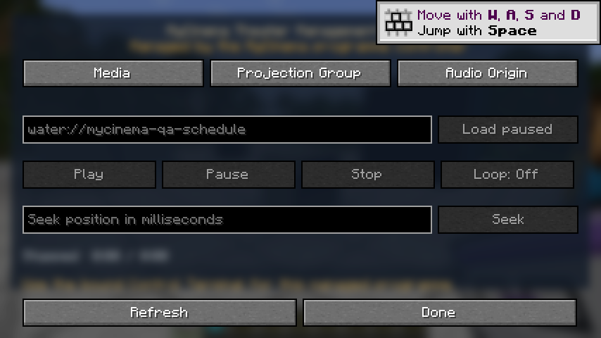

**简体中文** · [English](README_EN.md)

# MyCinema — 在 Minecraft 里开一家真正能放电影的影院

MyCinema 是面向 **Minecraft Java 1.21.1 / NeoForge** 的影院运营模组。它不是只有座椅和装饰方块：你可以建立电影库，把多段影片编成节目单，为影厅排片，让放映机组同步播放，并用 TMS、经理终端、平板、灯光、门禁、海报和信息屏管理整座影院。

> Open a cinema that actually plays films in Minecraft: catalogue films, assemble programmes, schedule screenings, synchronize projector groups, and operate the venue from one management system.

**作者与 MyCinema / KUMO 原创资产：[`sdy623`](https://github.com/sdy623)**

## 游戏内截图

| 真实 H.264/AAC 电影播放 | 影院管理器：播放、设备、排片、灯光与信息 |
|---|---|
|  |  |
| IMAX GT 双机柜与完整地板 | TMS 终端与媒体控制页 |
|  |  |



这些截图来自自动客户端验收流程：它实际加载 MyCinema 美术资源、解码测试影片、同步两台放映机，并验证退出重连后仍能恢复影院、影厅与播放控制状态。

## 它首先是一个“放电影”的模组

MyCinema 把一次放映拆成真实影院里可管理的流程：

```text
影片来源 → 电影库 → 有顺序的节目单 → 影厅排片
       → 放映机组同步播放 → 灯光 / 门 / 红石场景联动
       → 大堂信息屏、海报与座位系统服务观众
```

### 🎬 电影播放与节目单

- 把视频来源登记成电影条目，而不是每次临时向单个屏幕粘贴地址。
- 一个节目最多可由 **16 个片段**组成，可按顺序播放正片、片头、广告、预告或谢幕素材。
- 片段之间有可控的转场空隙；当前默认值为 **3 秒**。
- 支持播放、暂停、停止、跳转和进度控制，并让同一影厅的显示设备共享放映状态。
- 可保存放映快照，用于恢复和继续管理正在进行的场次。

### 🗂 电影库

- 每个世界最多登记 **64 部电影**。
- 集中保存片名、媒体来源和节目关联，避免各影厅重复配置。
- 来源可以是 WaterMedia 支持的网络媒体或服务器允许的文件来源。
- 私有图片和媒体传输设有体积限制，防止单个世界被无限数据占满。

### 🗓 排片与自动放映

- 为影厅创建有日期和时间的场次。
- 每个世界最多管理 **128 个场次**。
- 到点后由服务器侧调度放映，不依赖某位玩家一直打开控制界面。
- 节目开始和结束可触发红石场景输出，用来联动灯光、幕布、门或其他装置。

### 🎛 TMS、经理终端与平板

- **TMS 终端**：独立设备 ID `mycinema:tms_terminal`，使用 MyCinema 自有机柜美术；媒体、放映组和音源原点三页控制直接在终端中完成。
- **影院管理器**：集中查看影厅、节目、场次和输出。
- **经理终端**：用于固定控制台式管理。
- **平板**：在影厅内移动操作，处理播放、设备和排片。
- 一个世界最多登记 **16 个影厅**、**64 个场景输出**。
- 权限检查、员工门和操作范围限制让公共服务器可以把观众区与后台分开。

### 📽 放映机组、屏幕与声音

- MyCinema 提供两个真正独立的设备 ID：`mycinema:cinema_projector`（影院投影机）与 `mycinema:imax_gt_projector`（IMAX GT 投影机）。两套原创机柜/物品美术随 MyCinema 提供；IMAX GT 是并排双机柜，视觉尺寸约 **2.875 × 1.4 × 2.48 格**，占用居中的 **3 × 2 × 3 / 18 格**碰撞空间。透明占位格不会裁掉下方地板，破坏任一部件都只回收一台设备。
- 将同一影厅的显示设备组成放映组，统一管理节目和播放状态。
- 支持设置几何、朝向、尺寸、裁切和屏幕模式，以适配单厅、多厅和异形幕布。
- 音量和播放控制跟随放映逻辑，而不是让每块屏幕各自失控。
- 使用**官方原版 WaterFrames + WaterMedia 固定版本**；影院专用行为全部由 MyCinema 自有兼容层提供。

### 🖼 海报、信息屏与广告位

- 大堂信息屏可显示场次、影厅和节目状态。
- 墙面板默认可组成 **16 × 16** 网格，硬上限为 **32 × 32**。
- 默认最多 **256** 块面板，硬上限 **1024** 块。
- 广告面单边最大 **16 格**，尺寸调节步长为 **0.125 格**。
- 海报来源单边最大 **8192 像素**。
- 私有图片默认单张上限 **64 MiB**，绝对上限 **256 MiB**，单世界总量上限 **512 MiB**。

### 🪑 座位与排号

- 一个世界最多登记 **4096 个座位**。
- 排号和座号范围均为 **1–999**。
- 支持排号引导、座位工具和影院高背座椅，方便把建筑变成可管理的观众厅。

### 🚪 员工门、权限与后台区域

- 员工门可限制非工作人员进入放映室或管理区。
- 关键管理动作由服务器验证，不把权限判断交给客户端。
- 影院管理员可以把播放控制交给指定人员，而不是任何观众都能操作。

### 💡 场景与红石联动

- 最多配置 **64 个红石场景输出**。
- 可把开场、散场和自动化状态连接到厅灯、门、幕布及其他红石设备。
- 目标是让“开始放映”成为一条完整的影院操作，而不只是屏幕开始出画面。

### 🧭 游戏内思索教程

- 安装官方 Ponder 后，把鼠标移到馆长终端、TMS、影院放映机、IMAX GT 放映机、信息屏、座位／排号指示牌或员工读卡器上，按住默认的 **W** 键即可打开交互式教程。
- 首发提供 **7 个独立中英文场景**，逐步演示影院建档、TMS 与放映机组、IMAX GT 的 3 × 2 × 3 净空、信息屏绑定、座位编号和员工门禁。
- 场景结构与文本打包在 MyCinema 中；Ponder 与其 Flywheel 运行时保持为未修改的外部依赖，不装进 MyCinema JAR。

## 一场电影怎样开始

1. **登记影厅**：在管理系统中创建影厅并确认后台权限。
2. **加入影片**：把合法可播放的媒体来源登记到电影库。
3. **组成节目**：按顺序加入片头、广告、预告和正片等片段。
4. **绑定放映组**：把屏幕、投影和音频设备归入该影厅。
5. **校准画面**：设置方向、比例、裁切、显示模式和音量。
6. **创建场次**：选择影厅、节目与开场时间。
7. **开始放映**：由排片自动触发，或由 TMS、终端、平板手动控制。
8. **联动场景**：用红石输出控制灯光、门和幕布。

游戏内手册提供中文和英文说明，覆盖版本匹配、影厅登记、媒体来源、放映组、几何校准、音频、播放、跳转、排片、自动化、灯光与门、信息屏、海报、电影库、座位、员工权限和扩展上限。需要现场演示时，可直接对上述 7 个核心物品按住 **W** 打开思索教程。

## 当前容量与限制

以下数值来自当前源码；它们是现有默认值或硬上限，不是宣传估算。

| 项目 | 当前值 |
|---|---:|
| 每世界影厅 | 16 |
| 每世界场次 | 128 |
| 每世界电影 | 64 |
| 每个节目片段 | 16 |
| 播放快照 | 256 |
| 默认片段转场 | 3 秒 |
| 场景 / 红石输出 | 64 |
| 每世界座位 | 4096 |
| 排号、座号 | 1–999 |
| 墙面板默认网格 | 16 × 16 |
| 墙面板硬上限 | 32 × 32 |
| 面板总数默认 / 硬上限 | 256 / 1024 |
| 广告面单边 / 调节步长 | 16 格 / 0.125 格 |
| 海报来源单边 | 8192 px |
| 私有图片单张默认 / 绝对上限 | 64 / 256 MiB |
| 私有图片单世界总量 | 512 MiB |

## 支持版本与依赖

| 组件 | 固定版本 | 用途 |
|---|---|---|
| Minecraft Java | `1.21.1` | 游戏版本 |
| NeoForge | `21.1.244`–`<21.2` | 模组加载器 |
| WaterFrames | `3.0.0-alpha.1` | 显示框架 |
| WaterMedia | `3.0.0` | 媒体播放 API |
| WaterMedia Binaries | `3.0.0` | 客户端音视频解码运行时 |
| WaterUI | 随 WaterFrames `3.0.0-alpha.1` 提供 | WaterFrames 官方包内的界面运行时 |
| Ponder | `1.0.87+mc1.21.1` | 客户端交互式思索教程 |
| Flywheel | `1.0.4`（由 Ponder 传递解析） | Ponder 客户端渲染运行时 |

### 构建时会自动下载 WaterFrames / WaterMedia / Ponder

不需要手工把依赖 JAR 放进 `libs/`。运行构建后，Gradle 会从 Modrinth Maven 与 Creators of Create Maven 下载固定的官方版本到本机 Gradle 缓存：

```text
WaterFrames  maven.modrinth:eBzFuVTM:3q7i6sG3
WaterMedia   maven.modrinth:G922NeHS:7aLfBD61
WM Binaries  maven.modrinth:4997XcoK:IvgVb1Pv
Ponder       net.createmod.ponder:ponder-neoforge:1.0.87+mc1.21.1
```

这些依赖只用于编译和开发运行，**不会被复制进 MyCinema JAR**。发布页必须声明固定版本的 WaterFrames、WaterMedia、WaterMedia Binaries 与 Ponder；Gradle 会从 Ponder 的元数据继续解析 Flywheel `1.0.4`。WaterUI 已由指定的官方 WaterFrames 文件提供。只从 GitHub 手工下载 JAR 的玩家还需要从各自官方渠道安装这些依赖；可从 [Creators of Create 官方 Maven](https://maven.createmod.net/net/createmod/ponder/ponder-neoforge/1.0.87%2Bmc1.21.1/) 取得 Ponder，并从 [Flywheel 官方 Maven](https://maven.createmod.net/dev/engine-room/flywheel/flywheel-neoforge-1.21.1/1.0.4/) 取得它要求的 Flywheel。

## 安装

1. 安装 Minecraft Java 1.21.1 与兼容的 NeoForge 21.1.x。
2. 安装上表指定的官方 WaterFrames、WaterMedia、WaterMedia Binaries、Ponder 与 Flywheel；WaterUI 已包含在 WaterFrames 中。使用能解析 Maven 传递依赖的开发环境时，Flywheel 会随 Ponder 自动解析。
3. 把 MyCinema JAR 放入实例的 `mods` 文件夹。
4. 首次进入世界后先阅读游戏内手册，再登记影厅与影片。
5. 更新前备份世界；不要在保留 MyCinema 方块和数据时直接移除模组。

从源码构建时，成品位于 `build/libs/`。MyCinema JAR 不内置外部依赖；启动前必须先安装上表的固定官方版本。专用服务器不需要安装客户端专用的 Ponder 与 Flywheel。

## 官方依赖兼容实现已经完成

电影库、节目、TMS、投影组、镜像、音频、权限、自动化和网络状态都由 MyCinema 自有代码实现。WaterFrames 与 WaterMedia 保持未修改，只通过公开 API 和少量固定版本、服务器权威的 Mixin 连接点参与显示与播放。

- [x] 不追踪、不嵌入、不再分发第三方依赖 JAR
- [x] Gradle 自动下载固定的官方 WaterFrames / WaterMedia
- [x] Ponder 1.0.87 接入 7 个双语教程，结构蓝图与翻译由自动检查锁定
- [x] MyCinema 自有实现覆盖终端、投影、镜像、声音、排片与权限
- [x] 使用官方依赖完成编译与打包
- [x] 48 个 GameTest 类、241 个运行时用例纳入强制门槛
- [x] 干净客户端、两次启动专用服务器和真实 H.264/AAC 电影播放纳入同一自动流程
- [x] 最终 JAR 经过许可证与第三方类检查

实现对应关系见 [官方依赖兼容实现](docs/UPSTREAM_COMPATIBILITY.md)，发布边界见 [发布清单](docs/RELEASE_CHECKLIST.md)。

## 为什么不把 WaterFrames / WaterMedia 一起发布

MyCinema 的开源包不嵌入、不复制、不重打包这两个项目，也不把非官方变体伪装成官方依赖。兼容方案是：

1. **影院业务逻辑由 MyCinema 自己实现**：电影库、节目、排片、影厅、投影组、权限和自动化都放在 MyCinema 命名空间。
2. **Mixin 只做窄范围运行时连接**：只连接官方版本已经存在的生命周期和行为点，不复制上游实现。
3. **固定目标版本并快速失败**：仅支持经过完整验证的版本；版本不匹配时明确报错，不静默破坏世界数据。
4. **外部依赖保持原样**：玩家或启动器从官方渠道取得它们，MyCinema 不重新打包或再许可。

工程方案见 [兼容迁移计划](docs/COMPATIBILITY_MIGRATION.md)。

## 构建

Windows：

```text
gradlew.bat build
```

Linux / macOS：

```text
./gradlew build
```

Gradle 会自动解析固定的官方依赖，成功构建后在 `build/libs/` 生成 MyCinema JAR。

## 一条命令跑完发布验证

Windows：

```text
gradlew.bat verifyRelease
```

这条命令依次完成源码与模型检查、7 个 Ponder 场景的结构与双语文本检查、48 个 GameTest 类的 241 个运行时用例、两次启动的专用服务器、干净客户端、真实 H.264/AAC 电影播放、Ponder 场景实际编译与截图、退出重连、解码线程释放和最终 JAR 合规检查。客户端结果与截图位于 `build/release-evidence/client/`，专用服务器结果位于 `build/release-evidence/dedicated/`。

## 发布前合规检查

```text
python tools/check_release_compliance.py
```

该检查会拒绝：

- 捆绑的第三方 JAR；
- 非官方分支或本地文件依赖；
- 复制进 MyCinema 的 WaterFrames、WaterUI 或 WaterMedia 包名；
- 构建产物中被打包进去的上游类；
- 已知不应公开的私有构建标识。

## 数据、隐私与服务器责任

- 媒体来源由服务器或影院管理员配置；请只播放你有权使用的内容。
- 网络媒体会让相应播放端连接外部媒体服务，服务器管理者应向玩家说明所用来源。
- 私有图片传输有单张和世界总量限制，但公开服务器仍应设置权限并定期备份。
- 报告安全问题请阅读 [SECURITY.md](SECURITY.md)，不要在公开 Issue 中直接发布可利用细节。

## 文档索引

- [制作与自动化测试计划](docs/DEVELOPMENT_PLAN.md)
- [官方依赖兼容实现](docs/UPSTREAM_COMPATIBILITY.md)
- [开源与第三方许可审查](docs/OPEN_SOURCE_AUDIT.md)
- [官方依赖兼容迁移计划](docs/COMPATIBILITY_MIGRATION.md)
- [发布前检查清单](docs/RELEASE_CHECKLIST.md)
- [第三方组件与资产说明](THIRD_PARTY.md)
- [贡献指南](CONTRIBUTING.md)
- [安全报告](SECURITY.md)

游戏内中英双语手册文本位于 `src/main/resources/assets/mycinema/lang/`，会随功能迁移同步更新。

## 许可证

MyCinema 自有源代码以 [Apache License 2.0](LICENSE) 发布，具体范围和资产归属见 [NOTICE](NOTICE)。WaterFrames、WaterMedia、WaterUI、Ponder、Flywheel、Minecraft、NeoForge 及其他依赖继续适用各自的许可证和条款；它们不包含在 MyCinema 的 Apache 2.0 授权中。

MyCinema 与 Mojang、Microsoft、WaterFrames、WaterMedia、WaterUI、NeoForge、Iris 或 Sodium 无隶属或官方背书关系。
