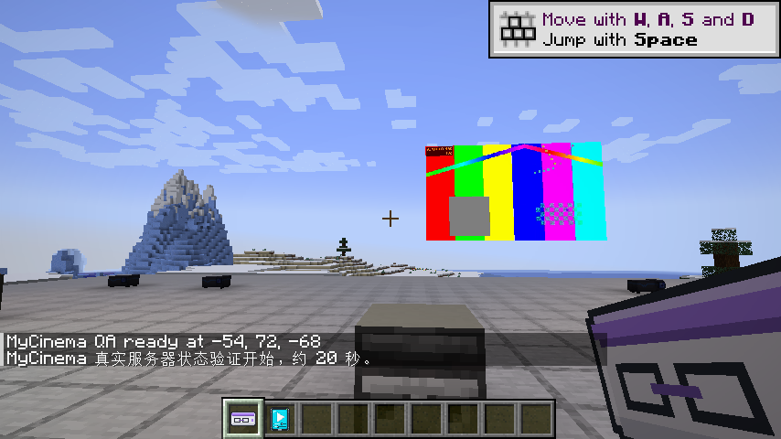
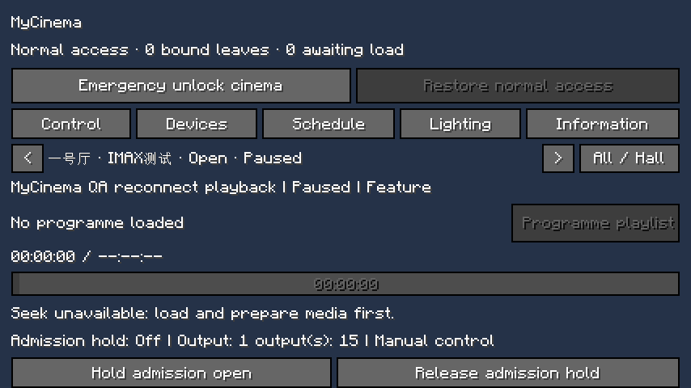
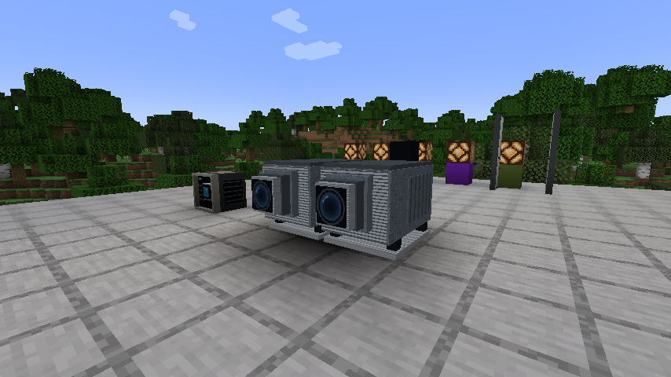
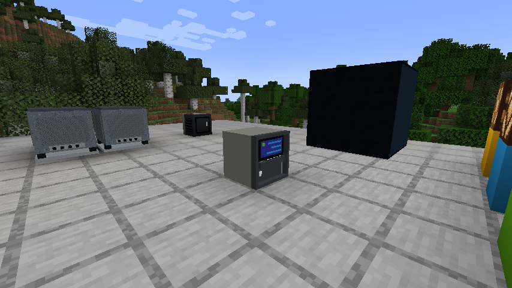
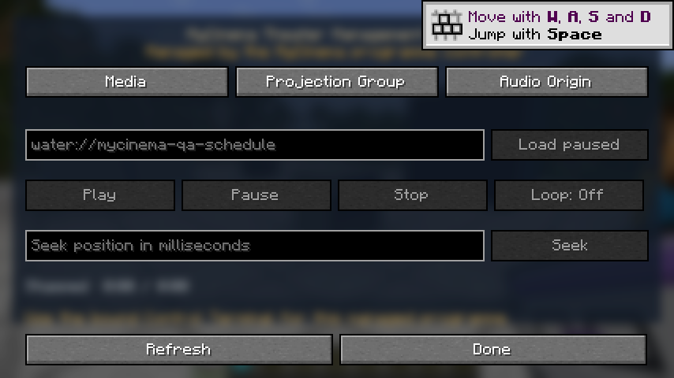

[简体中文](README.md) · **English**

# MyCinema — Open a cinema that actually plays films in Minecraft

MyCinema is a cinema-operations mod for **Minecraft Java 1.21.1 / NeoForge**. It is more than seats and decorative blocks: build a film catalogue, assemble multi-clip programmes, schedule screenings, synchronize projector groups, and operate the whole venue through a TMS, manager terminals, tablets, lighting, staff doors, posters, and information displays.

> 在 Minecraft 里开一家真正能放电影的影院：管理影片、编排节目、安排场次、同步放映，并从一套系统控制整家影院。

**Author and creator of the original MyCinema / KUMO assets: [`sdy623`](https://github.com/sdy623)**

## In-game screenshots

| Real H.264/AAC film playback | Cinema Manager: playback, devices, schedules, lighting, and information |
|---|---|
|  |  |
| Parallel IMAX GT cabinets with an intact floor | TMS terminal and media controls |
|  |  |



These screenshots come from the automated client acceptance run. It loads the MyCinema art in-game, decodes the test film, synchronizes two projectors, and verifies that cinema, auditorium, and playback-control state survives leaving and reconnecting.

## First and foremost, this mod plays films

MyCinema turns a screening into a manageable cinema workflow:

```text
Media source → Film catalogue → Ordered programme → Auditorium schedule
             → Synchronized projector group → Lighting / doors / redstone cues
             → Lobby displays, posters, and seating for the audience
```

### 🎬 Film playback and programmes

- Register media sources as reusable films instead of pasting a URL into every individual screen.
- Build a programme from up to **16 ordered clips**: features, bumpers, advertisements, trailers, or closing material.
- Set a controlled gap between clips; the current default is **3 seconds**.
- Play, pause, stop, seek, and control progress while all displays in an auditorium share one screening state.
- Save playback snapshots so an active screening can be recovered and managed after reconnecting.

### 🗂 Film catalogue

- Register up to **64 films per world**.
- Keep titles, media sources, and programme associations in one place instead of repeating configuration in every auditorium.
- Use network media supported by WaterMedia or file sources permitted by the server.
- Private images and media transfers have size limits to prevent unbounded world data.

### 🗓 Scheduling and automatic screenings

- Create dated and timed screenings for each auditorium.
- Manage up to **128 screenings per world**.
- Start scheduled playback on the server without requiring a player to keep a control screen open.
- Trigger redstone scene outputs at programme start and finish for house lights, curtains, doors, and other devices.

### 🎛 TMS, manager terminals, and tablets

- **TMS terminal:** the independent `mycinema:tms_terminal` device uses MyCinema-owned cabinet art and provides Media, Projector Group, and Audio Origin pages on the terminal itself.
- **Cinema Manager:** see auditoriums, programmes, screenings, and outputs in one place.
- **Manager terminal:** operate the cinema from a fixed control desk.
- **Tablet:** control playback, devices, and schedules while moving through the venue.
- Register up to **16 auditoriums** and **64 scene outputs** in one world.
- Permission checks, staff doors, and operating-range limits separate public areas from back-of-house controls on multiplayer servers.

### 📽 Projector groups, screens, and sound

- MyCinema provides two genuinely independent device IDs: `mycinema:cinema_projector` and `mycinema:imax_gt_projector`. Both original cabinet/inventory art sets ship with MyCinema. IMAX GT is a pair of parallel cabinets, approximately **2.875 × 1.4 × 2.48 blocks** visually, with a centered **3 × 2 × 3 / 18-cell** collision footprint. Invisible occupancy cells do not cull the floor below, and breaking any part recovers exactly one device.
- Combine the displays in one auditorium into a projector group with shared programme and playback state.
- Adjust geometry, facing, size, crop, and display mode for single-screen, multiplex, and custom-shaped installations.
- Keep volume and transport controls tied to the screening instead of letting every display drift independently.
- Use the **official, unmodified WaterFrames and WaterMedia releases at pinned versions**; MyCinema provides all cinema-specific behavior through its own compatibility layer.

### 🖼 Posters, information displays, and advertising surfaces

- Show screenings, auditoriums, and programme status on lobby information displays.
- Compose wall panels in a **16 × 16** grid by default, with a hard limit of **32 × 32**.
- Use up to **256** panels by default, with a hard limit of **1024**.
- Advertising surfaces can be up to **16 blocks per side**, adjusted in **0.125-block** steps.
- Poster sources can be up to **8192 pixels per side**.
- Private images default to **64 MiB each**, with a **256 MiB** absolute per-image limit and a **512 MiB** per-world total.

### 🪑 Seating and numbering

- Register up to **4096 seats per world**.
- Use row and seat numbers from **1–999**.
- Row guides, seating tools, and cinema high-back seats turn a build into a manageable auditorium.

### 🚪 Staff doors, permissions, and back-of-house areas

- Restrict projection rooms and management areas with staff doors.
- Validate important management actions on the server rather than trusting the client.
- Let cinema administrators grant playback control to designated staff instead of every visitor.

### 💡 Scenes and redstone automation

- Configure up to **64 redstone scene outputs**.
- Connect opening, closing, and automation states to house lights, curtains, doors, and other redstone devices.
- Make “start screening” a complete cinema operation—not merely a picture appearing on a screen.

### 🧭 Interactive Ponder tutorials

- With the official Ponder library installed, hover the Control Terminal, TMS, Cinema Projector, IMAX GT Projector, Information Panel, Seat / Row Guide, or Staff Reader and hold the default **W** key.
- The first release includes **seven independent English and Chinese scenes** covering venue setup, TMS and projector groups, IMAX GT's 3 × 2 × 3 clearance, public information, seat numbering, and staff access.
- MyCinema ships the scene structures and text. Ponder and its Flywheel runtime remain unmodified external dependencies and are not embedded in the MyCinema JAR.

## Starting a screening

1. **Register an auditorium:** create it in the management system and confirm staff permissions.
2. **Add films:** register media sources that you are authorized to play in the film catalogue.
3. **Build a programme:** order bumpers, advertisements, trailers, features, and other clips.
4. **Bind a projector group:** assign screens, projection, and audio devices to the auditorium.
5. **Calibrate the image:** set orientation, aspect, crop, display mode, and volume.
6. **Create a screening:** select the auditorium, programme, date, and start time.
7. **Start the show:** let the schedule trigger it or control it manually from the TMS, terminal, or tablet.
8. **Run the venue:** use redstone outputs to coordinate lights, doors, and curtains.

The in-game manual is available in English and Chinese. It covers version matching, auditorium registration, media sources, projector groups, geometry calibration, audio, playback, seeking, scheduling, automation, lighting and doors, information displays, posters, the film catalogue, seating, staff permissions, and capacity limits. For an animated walkthrough, hold **W** over any of the seven core tutorial items listed above.

## Current capacities and limits

These values come from the current source code. They are current defaults or hard limits, not marketing estimates.

| Item | Current value |
|---|---:|
| Auditoriums per world | 16 |
| Screenings per world | 128 |
| Films per world | 64 |
| Clips per programme | 16 |
| Playback snapshots | 256 |
| Default gap between clips | 3 seconds |
| Scene / redstone outputs | 64 |
| Seats per world | 4096 |
| Row and seat numbers | 1–999 |
| Default wall-panel grid | 16 × 16 |
| Hard wall-panel grid limit | 32 × 32 |
| Default / hard total panel limit | 256 / 1024 |
| Advertising side / adjustment step | 16 blocks / 0.125 blocks |
| Maximum poster-source side | 8192 px |
| Default / absolute private image limit | 64 / 256 MiB |
| Total private image data per world | 512 MiB |

## Supported versions and dependencies

| Component | Pinned version | Purpose |
|---|---|---|
| Minecraft Java | `1.21.1` | Game version |
| NeoForge | `21.1.244`–`<21.2` | Mod loader |
| WaterFrames | `3.0.0-alpha.1` | Display framework |
| WaterMedia | `3.0.0` | Media playback API |
| WaterMedia Binaries | `3.0.0` | Client audio/video decoding runtime |
| WaterUI | Supplied by WaterFrames `3.0.0-alpha.1` | Interface runtime inside the official WaterFrames artifact |
| Ponder | `1.0.87+mc1.21.1` | Client-side interactive tutorials |
| Flywheel | `1.0.4` (transitive from Ponder) | Ponder's client rendering runtime |

### WaterFrames, WaterMedia, and Ponder download automatically when building

You do not need to place dependency JARs in `libs/`. Gradle downloads the pinned official releases from Modrinth Maven and the Creators of Create Maven into the local Gradle cache:

```text
WaterFrames  maven.modrinth:eBzFuVTM:3q7i6sG3
WaterMedia   maven.modrinth:G922NeHS:7aLfBD61
WM Binaries  maven.modrinth:4997XcoK:IvgVb1Pv
Ponder       net.createmod.ponder:ponder-neoforge:1.0.87+mc1.21.1
```

These dependencies are used for compilation and development runs only. They are **not copied into the MyCinema JAR**. Release pages must declare the pinned WaterFrames, WaterMedia, WaterMedia Binaries, and Ponder versions; Gradle resolves Flywheel `1.0.4` from Ponder's metadata. WaterUI is supplied by the specified official WaterFrames file. Manual GitHub installs must add every dependency separately: obtain Ponder from the [Creators of Create Maven](https://maven.createmod.net/net/createmod/ponder/ponder-neoforge/1.0.87%2Bmc1.21.1/) and its required Flywheel runtime from the [Flywheel Maven](https://maven.createmod.net/dev/engine-room/flywheel/flywheel-neoforge-1.21.1/1.0.4/).

## Installation

1. Install Minecraft Java 1.21.1 and a compatible NeoForge 21.1.x release.
2. Install the pinned official WaterFrames, WaterMedia, WaterMedia Binaries, Ponder, and Flywheel releases. WaterUI is included in WaterFrames. Development setups that resolve Maven transitive dependencies obtain Flywheel through Ponder automatically.
3. Put the MyCinema JAR in the instance's `mods` folder.
4. Enter a world, read the in-game manual, then register an auditorium and films.
5. Back up the world before updating. Do not remove MyCinema while keeping its blocks and world data in use.

When building from source, the finished JAR is written to `build/libs/`. External dependencies are not embedded in it and must be installed before launching the game. Dedicated servers do not need the client-only Ponder and Flywheel pair.

## Native compatibility implementation is complete

The film catalogue, programmes, TMS, projector groups, mirroring, audio, permissions, automation, and network state are implemented in MyCinema's own code. WaterFrames and WaterMedia remain unmodified and participate only through public APIs plus a small set of pinned-version, server-authoritative Mixin connection points.

- [x] No third-party dependency JARs are tracked, embedded, or redistributed
- [x] Gradle automatically downloads the pinned official WaterFrames and WaterMedia releases
- [x] Ponder 1.0.87 provides seven bilingual tutorials with checked structures and translation inventories
- [x] MyCinema's own implementation covers terminals, projection, mirroring, sound, scheduling, and permissions
- [x] Compilation and packaging use the official dependencies
- [x] 48 GameTest classes and 241 runtime cases are mandatory release gates
- [x] A clean client, two-start dedicated server run, and real H.264/AAC film playback are part of one automated workflow
- [x] The finished JAR is checked for licensing boundaries and bundled third-party classes

See [Upstream Compatibility](docs/UPSTREAM_COMPATIBILITY.md) for the implementation map and the [Release Checklist](docs/RELEASE_CHECKLIST.md) for the release boundary.

## Why WaterFrames and WaterMedia are not redistributed

The MyCinema open-source package does not embed, copy, or repackage either project, and it does not present unofficial variants as official dependencies. The compatibility design is:

1. **Cinema business logic belongs to MyCinema:** the film catalogue, programmes, schedules, auditoriums, projector groups, permissions, and automation stay in the MyCinema namespace.
2. **Mixins are narrow runtime connections:** they connect to existing lifecycle and behavior points in the pinned official releases without copying upstream implementations.
3. **Targets are pinned and fail fast:** only fully verified versions are supported; a mismatch produces an explicit error instead of silently risking world data.
4. **External dependencies remain unchanged:** players or launchers obtain them from their official distribution channels; MyCinema neither repackages nor relicenses them.

See the [Compatibility Migration Plan](docs/COMPATIBILITY_MIGRATION.md) for the engineering design.

## Build

Windows:

```text
gradlew.bat build
```

Linux / macOS:

```text
./gradlew build
```

Gradle resolves the pinned official dependencies automatically and writes the finished MyCinema JAR to `build/libs/`.

## Run the complete release verification with one command

Windows:

```text
gradlew.bat verifyRelease
```

This runs source and model checks, structure and bilingual-text checks for seven Ponder scenes, 241 runtime cases from 48 GameTest classes, two dedicated-server starts, a clean client, real H.264/AAC film playback, actual Ponder scene compilation and capture, leave-and-reconnect recovery, decoder-thread cleanup, and compliance checks on the final JAR. Client results and screenshots are written to `build/release-evidence/client/`; dedicated-server results are written to `build/release-evidence/dedicated/`.

## Pre-release compliance check

```text
python tools/check_release_compliance.py
```

The check rejects:

- bundled third-party JARs;
- unofficial forks or local-file dependencies;
- WaterFrames, WaterUI, or WaterMedia package namespaces copied into MyCinema;
- upstream classes packaged into the build output;
- known private-build identifiers that must not enter a public release.

## Data, privacy, and server responsibility

- Media sources are configured by the server or cinema administrator. Play only content you are authorized to use.
- Network media causes the playback client to connect to external media services; server operators should tell players which sources are in use.
- Private image transfers have per-image and per-world limits, but public servers should still configure permissions and make regular backups.
- Read [SECURITY.md](SECURITY.md) before reporting a security issue. Do not publish directly exploitable details in a public issue.

## Documentation

- [Development and automated-test plan](docs/DEVELOPMENT_PLAN.md)
- [Upstream compatibility implementation](docs/UPSTREAM_COMPATIBILITY.md)
- [Open-source and third-party licensing audit](docs/OPEN_SOURCE_AUDIT.md)
- [Compatibility migration plan](docs/COMPATIBILITY_MIGRATION.md)
- [Pre-release checklist](docs/RELEASE_CHECKLIST.md)
- [Third-party components and assets](THIRD_PARTY.md)
- [Contributing guide](CONTRIBUTING.md)
- [Security reporting](SECURITY.md)

The English and Chinese in-game manual text is stored in `src/main/resources/assets/mycinema/lang/` and is maintained alongside feature changes.

## License

MyCinema's own source code is released under the [Apache License 2.0](LICENSE); see [NOTICE](NOTICE) for scope and asset attribution. WaterFrames, WaterMedia, WaterUI, Ponder, Flywheel, Minecraft, NeoForge, and other dependencies remain subject to their own licenses and terms. They are not covered by MyCinema's Apache 2.0 grant.

MyCinema is not affiliated with or endorsed by Mojang, Microsoft, WaterFrames, WaterMedia, WaterUI, NeoForge, Iris, or Sodium.
